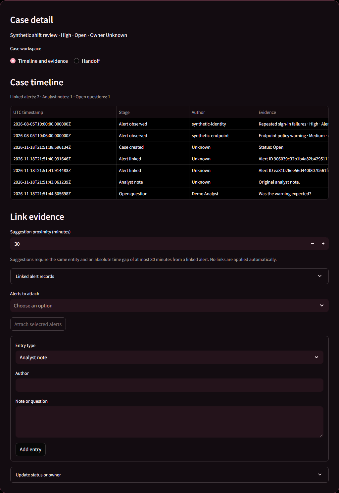
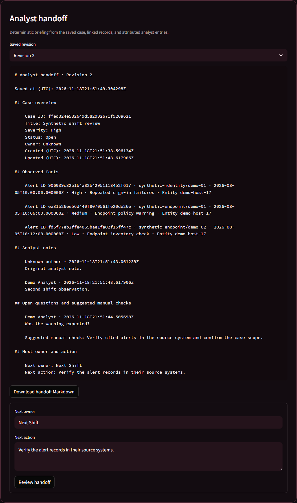

# CyberOps AI

CyberOps AI is a standalone, defensive SOC case-management dashboard. Analysts import alert records, link evidence to cases, and save reviewed handoff briefings for the next shift. This is a fresh implementation of case intake, investigation history, and Analyst Handoff.

**Author and maintainer** [Prashant Chauhan](https://github.com/itsprshnt20)

**Planned repository** [itsprshnt20/CyberOps-AI](https://github.com/itsprshnt20/CyberOps-AI)

## Screenshots

The OLED-black dashboard uses crimson panels and rose accents. Screenshots show synthetic case data.





## Windows setup

From PowerShell in the extracted project folder with Python 3.11:

```powershell
py -3.11 -m venv .venv
.\.venv\Scripts\python.exe -m pip install -r requirements.txt
.\.venv\Scripts\python.exe -m streamlit run app.py
```

Open [the local dashboard](http://127.0.0.1:8501). Installing dependencies downloads packages from PyPI. Runtime requires no service or key. The default database is `data/cyberops.sqlite3`. Set `CYBEROPS_DB_PATH` before starting the app for an isolated database.

## Two-minute walkthrough

1. Click **Load identity demo**, then **Load endpoint demo**. Load identity again to see **Duplicate: 2**. Both sources use the same parser and transaction as **Import JSON**.
2. Create a case and attach **Repeated sign-in failures**. **Endpoint policy warning** is suggested because it shares the entity and is six minutes away. Select and attach it explicitly.
3. Add an **Analyst note** and an **Open question**. They appear in the timeline with their author and timestamp.
4. Choose **Handoff**, enter **Next owner** and **Next action**, and click **Review handoff**. Inspect the draft, click **Save reviewed handoff**, and download revision 1 as Markdown.
5. Return to the timeline, attach **Endpoint inventory check** and add a note. Handoff shows revision 1 predates the case update. Review and save revision 2. Choose revision 1 in **Saved revision** to see and download its original content.

## Import and evidence

Use a UTF-8 JSON array of 1–3,000 objects, up to 1 MiB. Each object requires exactly these six fields. Timestamp offsets are normalized to UTC. Source and entity identifiers are lowercased. External IDs preserve case. Suggested links use a matching normalized entity and an inclusive absolute time gap from an already linked alert. Suggestions never attach records.

```json
[
  {
    "source": "synthetic-identity",
    "external_id": "demo-01",
    "timestamp": "2026-08-05T10:00:00Z",
    "severity": "High",
    "title": "Repeated sign-in failures",
    "entity": "demo-host-17"
  }
]
```

Severity must be Low, Medium, High, or Critical. Source, external ID, and entity accept a short identifier containing letters, digits, dots, underscores, colons, at signs, or hyphens. Use nonsensitive entities. A duplicate is the same source and external ID with identical normalized content. Conflicting content is reported and the original is preserved. Record errors identify a 1-based array position.

Cases use Open, Investigating, and Closed. Closing requires a resolution note. Saved alert facts quote source metadata with the linked alert ID. Analyst interpretations and open questions remain attributed separately. A save compares the reviewed draft to the current case version in the same transaction. Handoff exports are stored as immutable Markdown text, including their case ID, linked alert IDs, UTC timestamp and revision number.

```text
JSON or demo → Validate and deduplicate → SQLite alerts
                                                |
     Case queue → manual links / notes / changes → case timeline
                                                |
                      Review preview → save versioned Markdown → export
```

## Tests

```powershell
.\.venv\Scripts\python.exe -m unittest discover -s tests -v
```

For browser testing, use a clean database and run the server in one terminal and the smoke test in another.

```powershell
.\.venv\Scripts\python.exe -m pip install playwright==1.65.2
.\.venv\Scripts\python.exe -m playwright install chromium --only-shell
$env:CYBEROPS_DB_PATH = Join-Path $env:TEMP ("cyberops-smoke-" + [guid]::NewGuid() + ".sqlite3")
.\.venv\Scripts\python.exe -m streamlit run app.py
```

```powershell
.\.venv\Scripts\python.exe tests/browser_smoke.py
```

## Limitations

- Single-machine local app. Owner and author fields are analyst-entered labels. The app has no authentication or tenant access model and binds to loopback.
- SQLite stores imported evidence and drafts in a local unencrypted database. Handoffs are immutable through the application. A machine administrator can modify the database directly.
- An alert reports what its source recorded. The app does not establish attribution or run active investigation commands.

## GitHub handoff

**Repository description** Local SOC case management with linked alert evidence and versioned analyst handoff briefings.

**Resume bullet** Built a Streamlit and SQLite case dashboard with deduplicated alert intake and reviewed, revision-specific Markdown handoffs.

For a new empty remote, publish the local `main` branch after authenticating. If the target exists, inspect it first and preserve its history.

```powershell
git switch main
git remote add origin https://github.com/itsprshnt20/CyberOps-AI.git
git push -u origin main
```

Original source and demo fixtures use the [MIT License](LICENSE). Dependencies are installed separately under their upstream licenses.
